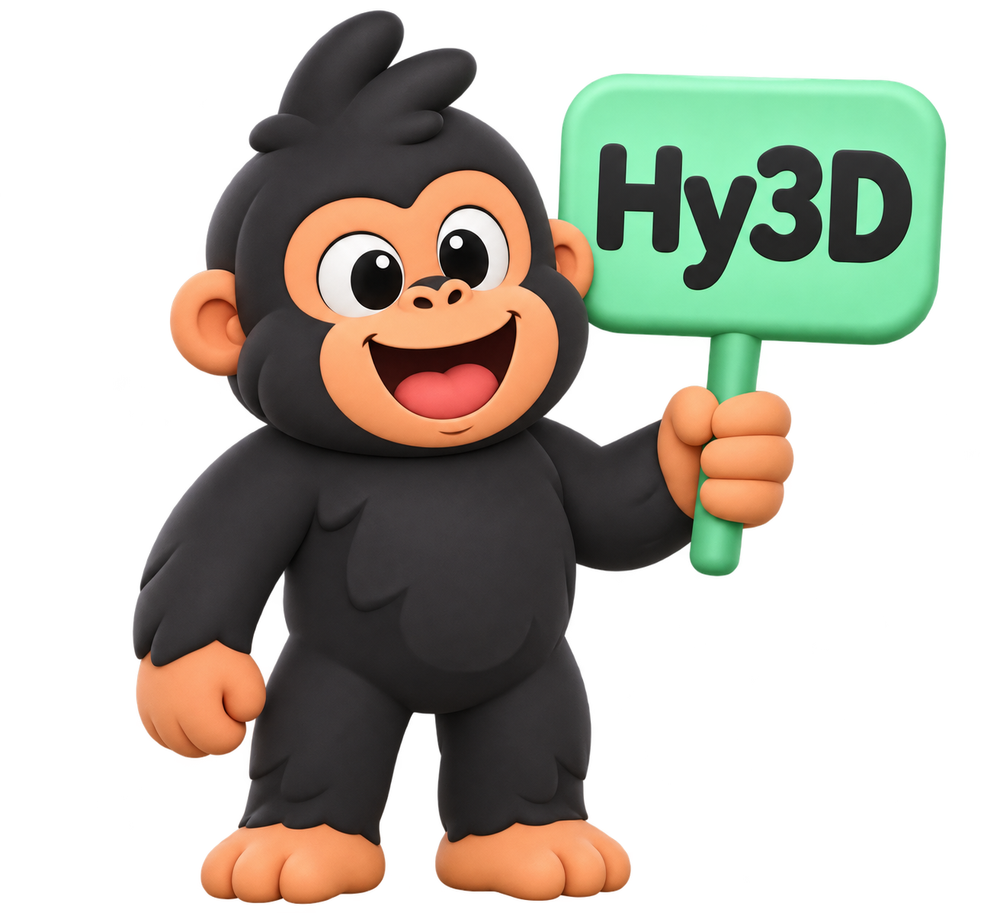
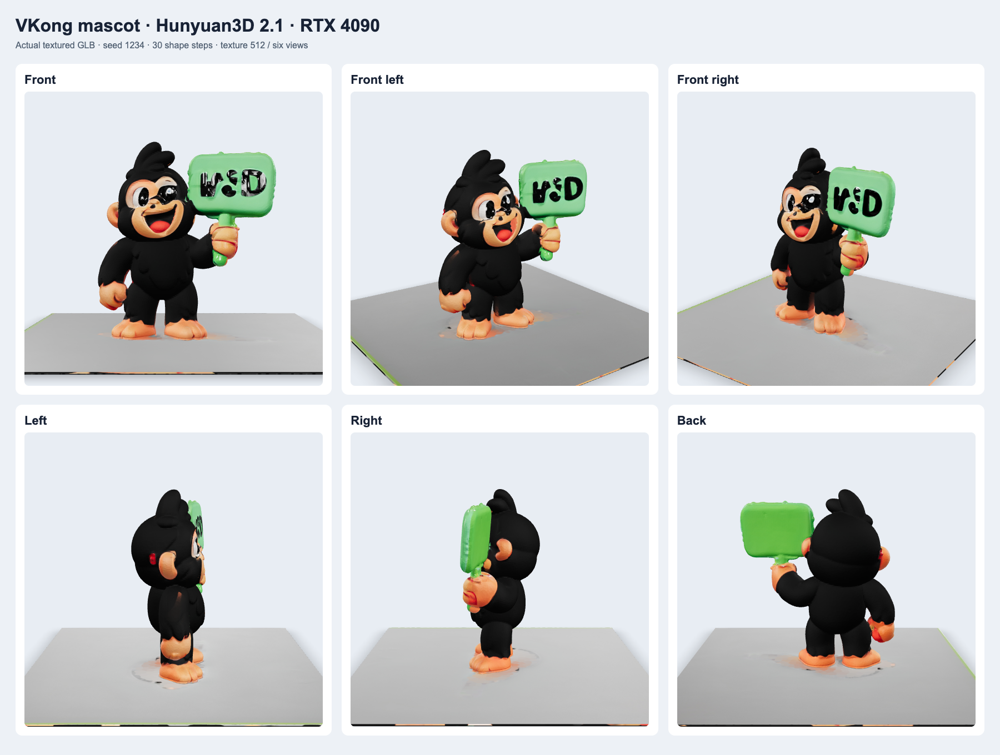
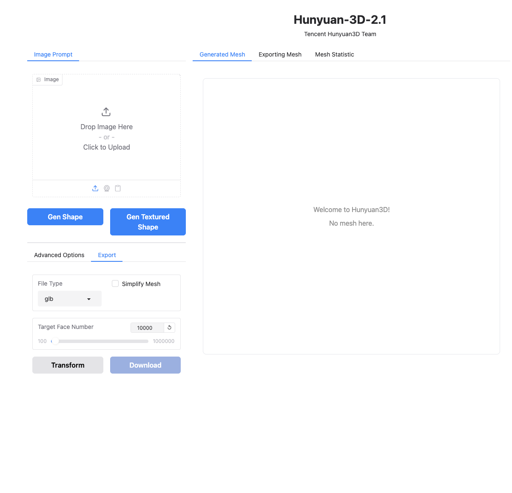
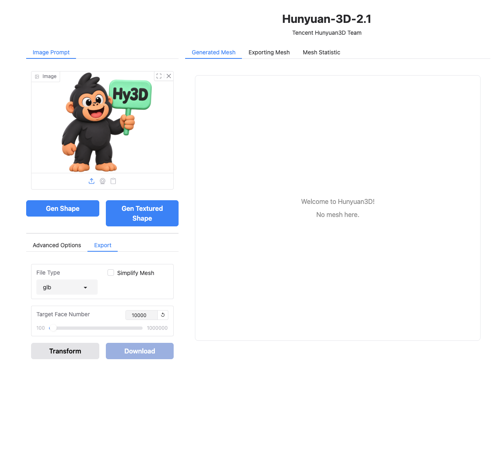
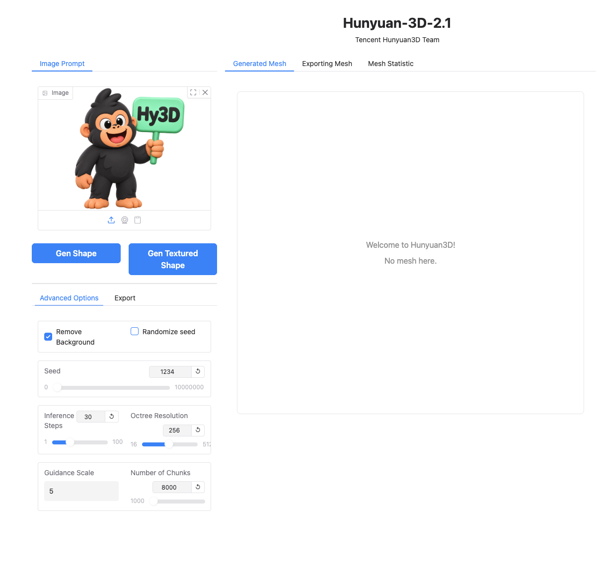
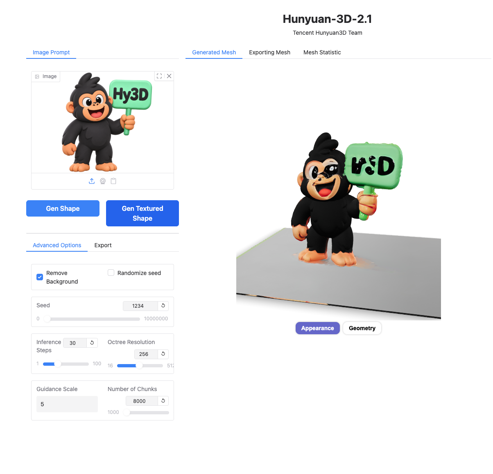
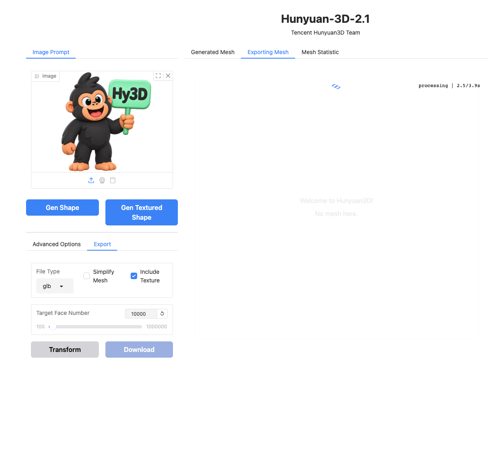
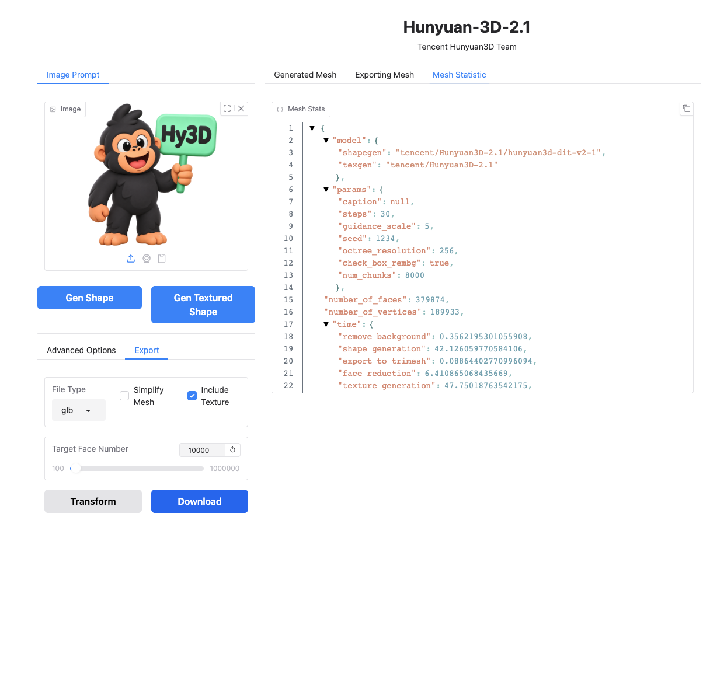
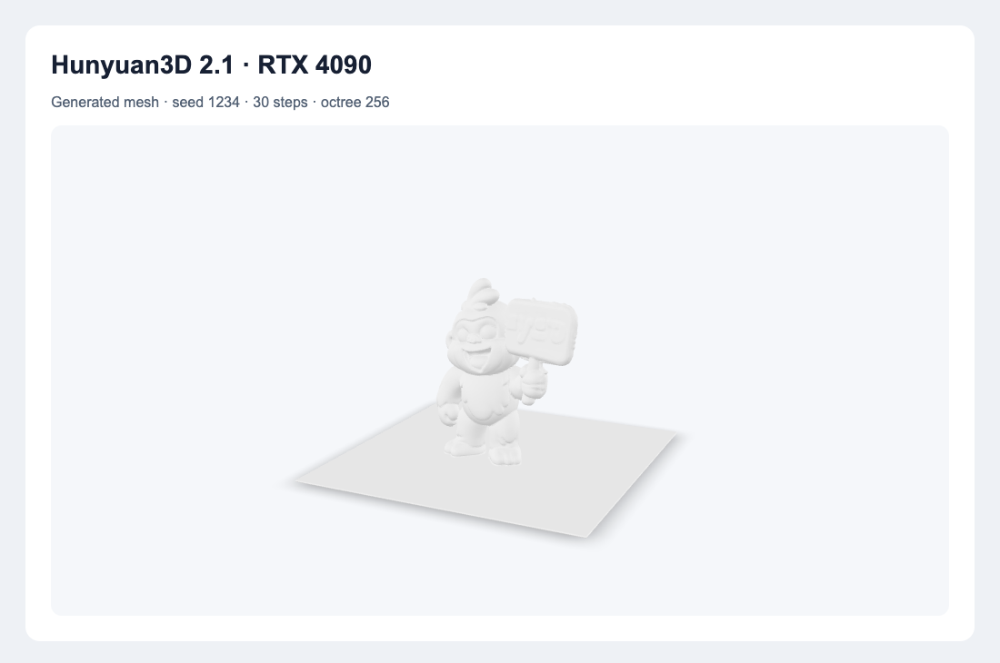

# Hunyuan3D 2.1 image-to-textured-3D on VKong

Upload an image, generate a 3D mesh with Hunyuan3D 2.1, and download a GLB.
The recipe runs shape and texture sequentially on one RTX 4090 24 GB.

**Validated on RTX 4090 24 GB:** setup, Gradio UI, shape generation, texture
generation, and PBR GLB export. The saved outputs below are from an actual GPU run.

## VKong mascot example



This is the only example input used in this recipe. It was generated from the
VKong mascot reference with the exact sign text **Hy3D**. The [image-generation
prompt](artifacts/vkong-hy3d/prompt.txt) is saved with the input.

### Actual textured result



[Download textured GLB](artifacts/vkong-hy3d/textured.glb) ·
[Shape GLB](artifacts/vkong-hy3d/shape.glb) ·
[Measurements](artifacts/vkong-hy3d/result.json)

Individual views: [front](artifacts/vkong-hy3d/textured-front.png),
[front left](artifacts/vkong-hy3d/textured-front-left.png),
[front right](artifacts/vkong-hy3d/textured-front-right.png),
[left](artifacts/vkong-hy3d/textured-left.png),
[right](artifacts/vkong-hy3d/textured-right.png),
[back](artifacts/vkong-hy3d/textured-back.png).

| Stage | Inference excluding model loading | Peak PyTorch allocated VRAM |
|---|---:|---:|
| Shape | 14.14 seconds | 7.63 GiB |
| Texture | 36.59 seconds | 13.52 GiB |

The recorded run used seed 1234, 30 shape steps, octree 256, guidance 5,
chunks 8000, and texture generation with six views at 512 resolution. The GLB
contains 40,000 faces and a 2048×2048 base-color texture. Cached stage loading
plus generation took 42.66 seconds for shape and 62.53 seconds for texture;
first-time model downloads take additional time. Peak allocated VRAM is an
allocator measurement, not total device usage. This is one execution sample,
not a general performance benchmark.

The supplied GLB is the pipeline output: lettering/face details have reconstruction
artifacts, and the generated geometry includes a flat base. The screenshots
preserve these details rather than retouching them.

Prerequisites: the VKong CLI, `vkong login`, and permission to download the
upstream models. This recipe uses workspace secret `huggingface` containing
`HF_TOKEN`; create it in your own terminal if it does not exist. Never commit the token.
The default is one RTX 4090 24 GB, 64 GB host RAM, and 150 GB disk.
The $2/hour `max_price` is a cap, not a quoted rental price.

## Run

```bash
cd hunyuan3d-21
vkong validate
vkong app list
vkong run --detach
```

Review the actual hourly price before accepting. Setup installs dependencies
and builds CUDA extensions. The UI starts without keeping both stages loaded;
the first generation downloads model weights. Both can
take several minutes, and the machine bills during setup and downloads.
Open the local URL printed by VKong. Reconnect with `vkong attach <machine>`
if the local connection closes.

## Try in Gradio

1. Open the local URL printed by `vkong attach`. The page should show the
   Hunyuan-3D-2.1 UI.

   

2. Upload `artifacts/vkong-hy3d/input.png` and wait for the VKong mascot to appear.

   

3. Open **Advanced Options**, disable **Randomize seed**, and use seed **1234**,
   **30** inference steps, octree resolution **256**, guidance **5**, and **8000** chunks.

   

4. Click **Gen Textured Shape**. The first request downloads the required weights;
   subsequent requests reuse the local cache. Keep the browser and App running.

   

5. Inspect the textured model in **Generated Mesh**. Drag to orbit and scroll to zoom.

   

6. Open **Export**, keep **GLB** and **Include Texture**, and click **Transform**.
   Wait for conversion to finish, then click **Download** to save the textured asset.
   The screenshot captures conversion in progress; the next step shows Download enabled.

   

7. Open **Mesh Statistic** to inspect the run parameters and stage timings.

   

The screenshots above come from the actual Gradio session on the rented RTX 4090.
The upstream sample gallery is cropped out; the VKong mascot is the only input used.
The corresponding shape has already been generated and saved:



[Download the VKong shape GLB](artifacts/vkong-hy3d/shape.glb).
Shape sampling and decoding took **14.14 seconds**, with **7.63 GiB** peak PyTorch
allocated VRAM. The shape stage took **42.66 seconds** including loading its cached
weights. The textured output is linked above.
These measurements are from one input and are not a general performance benchmark.

## Run the API smoke client

The included client uses the VKong mascot input with seed 1234, 30 steps,
guidance 5, octree resolution 256, and chunks 8000.
From this recipe directory, create a local client environment (separate from the GPU
runtime) and run:

```bash
uv venv --python 3.11 .client-venv
uv pip install --python .client-venv/bin/python gradio_client==2.0.1 trimesh==4.6.8
.client-venv/bin/python smoke_client.py http://127.0.0.1:<local-port>
```

It requests shape + texture, saves both GLBs and metadata under `artifacts/vkong-hy3d/`, and
checks the textured mesh. Its long HTTP timeout accommodates the first model load.
The client does not bypass model-download or runtime errors.

For repeated verification, use the same example image and seed twice. Confirm each
output downloads, opens as a nonempty mesh in a GLB viewer, and includes
materials/textures. A fixed seed helps comparison but does not promise identical
binary files across machines. Loading the web page alone is not a generation test.

Model downloads and generated files live on the machine disk. There is no Storage
volume: download results before stopping or replacing the machine. Clear old
outputs through the upstream UI where available, or restart on the same machine
when necessary; restarting does not guarantee old output files are removed.

## Stop

```bash
vkong app stop hunyuan3d-21
```

The machine keeps billing until stopped. Closing the browser or detaching the CLI
does not stop it.

## Publish and update

```bash
vkong deploy
```

This publishes the UI at the App URL. The UI does not add authentication;
only publish when you intend other users with access to that URL to submit work.
The queue is bounded to four requests with a default concurrency of one.
Update a published service with `vkong deploy`. For an unpublished App, use
`vkong attach <machine> --update`. If `setup.sh` changes, also change `init_cmd`
or explicitly rerun setup with `vkong attach <machine> --setup` before restarting.
Keep the machine after a failed build and fix it there.

## Runtime details

Upstream reports 10 GB VRAM for shape, 21 GB for texture, and approximately
29 GB for the combined pipeline. This recipe uses RTX 4090 24 GB and loads shape and texture sequentially,
unloading the previous stage before constructing the next. Each switch reloads
weights from the local model cache. Texture uses six views at 512 resolution; the measured peak allocated VRAM was
13.52 GiB in the recorded run.
A stage initialization error is surfaced in the generation request and logs.

Review the [Tencent Hunyuan 3D 2.1 Community License](https://github.com/Tencent-Hunyuan/Hunyuan3D-2.1/blob/82920d643c0dc2f7bfd7255f45f62d386edfe60c/LICENSE)
before use or hosting; it includes territory and other conditions. Dependencies
and downloaded models retain their own licenses.

Source is checked out at [`82920d643c0d`](https://github.com/Tencent-Hunyuan/Hunyuan3D-2.1/tree/82920d643c0dc2f7bfd7255f45f62d386edfe60c).
The recipe uses upstream UI/model loading rather than vendoring the project.
`launch.py` binds it to `0.0.0.0:$PORT` and limits the queue. `setup.sh` needs
root in the supplied CUDA development image. Requirements pin direct Python
dependencies; transitive dependencies and automatically downloaded model revisions
are not a complete reproducibility lock.

If setup fails, inspect `vkong attach <machine>`. Common areas to check are CUDA
compiler/driver compatibility, available disk, package resolution, and model-download
access. If only high-resolution generation fails, try the initial settings again
before changing GPU or budget.
