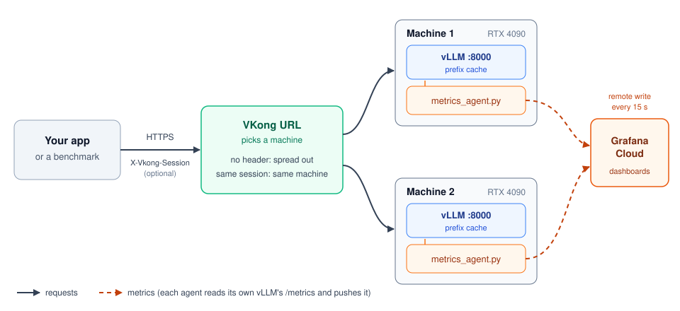
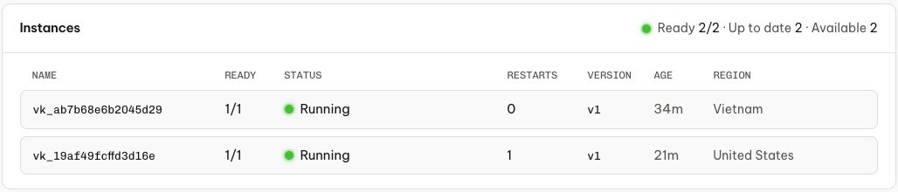
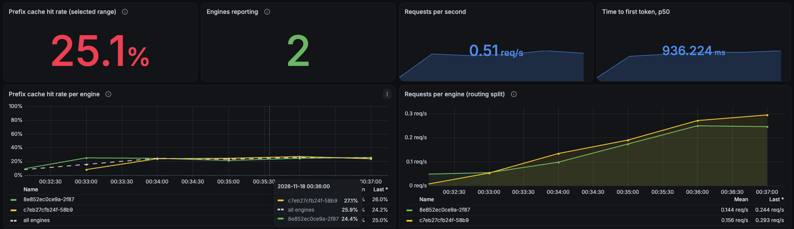
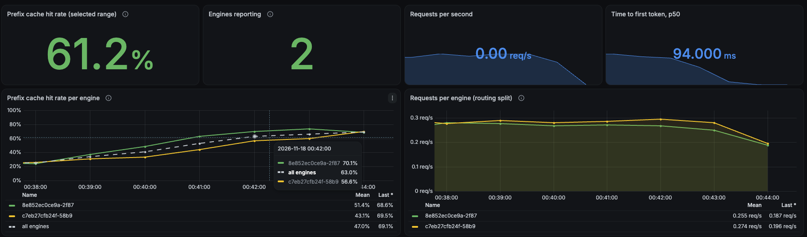
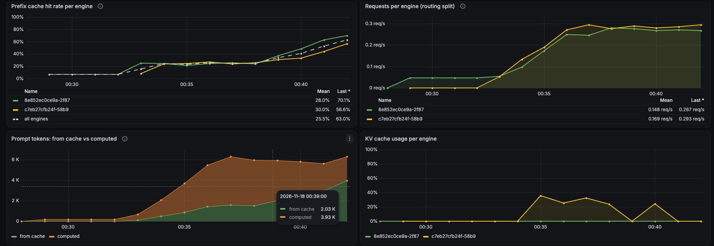

# LLM session routing: two machines, one header, Grafana

Run an LLM engine on two RTX 4090 machines behind one VKong URL, keep each chat
on the same machine, and watch the cache per machine in Grafana Cloud.

Session routing does not depend on the engine. Each engine has its own folder
with the same setup:

| Folder | Engine | Prefix cache |
|---|---|---|
| [`vllm/`](vllm) | vLLM | Automatic prefix caching |
| [`sglang/`](sglang) | SGLang | RadixAttention |

Both folders serve the same model (Qwen3-4B-Instruct-2507) on the same
machines with about the same KV cache size, and use the same benchmark.

**Result with vLLM:** with one header, the prefix cache hit rate went from
**25% to 61%** and follow-up messages got their first token **twice as fast**
(0.73 s instead of 1.47 s).

**Result with SGLang:** the hit rate went from **18% to 49%** and follow-up
messages got their first token in **0.89 s instead of 1.42 s**.



## Why route by session

In a chat, every new message resends the whole conversation. The engine keeps
the part it already computed in its **prefix cache** and skips it, but only on
the machine that computed it. If the next message lands on another machine, that
machine computes the whole conversation again.

Add the header `X-Vkong-Session: <conversation id>` and VKong sends every
message of that conversation to the same machine.

## How VKong routes

- **No header:** requests are spread over the machines in turn.
- **With `X-Vkong-Session`:** VKong hashes the value and the hash picks a
  machine. The same value always picks the same machine, so a conversation
  stays where its cache is. Different values spread evenly over the machines.
- **A busy machine is not overloaded:** if the chosen machine has more than
  1.25 times the average number of requests in progress, the request goes to
  the next machine instead, and comes back once it is less busy.
- **Machines come and go:** when a machine is added or stopped, only the
  sessions of that machine move.
- The header is used by VKong only; your App does not receive it.

There is nothing to set in `vkong.yaml` and no router to run.

## Files

| Path | What it is |
|---|---|
| `bench/` | The multi-round chat benchmark of vLLM production-stack, run from your laptop |
| `<engine>/vkong.yaml` | The App: two machines with one RTX 4090 each |
| `<engine>/serve.sh` | Starts the metrics agent, then the engine with prefix caching and an API key |
| `<engine>/metrics_agent.py` | Sends the engine's metrics to Grafana Cloud every 15 s, labelled by machine |
| `<engine>/dashboards/` | Grafana dashboards, split per machine |

Each engine folder is one VKong project: `vkong deploy` runs from it and sends
only that folder to the machines. Metrics are sent from each machine because
the public URL reaches the App, not one machine, so Grafana could not read each
machine from outside.

## Run it

You need the `vkong` CLI (after `vkong login`), a free Grafana Cloud account
and `uv`.

### 1. Grafana Cloud token

1. In grafana.com, open **Access Policies**, create a policy with only the
   `metrics:write` scope for your stack, and add a token (it is shown once).
2. Open your stack, then **Prometheus → Details**, and note the **Remote Write
   Endpoint** and the **Username / Instance ID**.

### 2. Secrets

In the VKong dashboard, open **Secrets → New secret** and create `grafana`:

| Key | Value |
|---|---|
| `METRICS_WRITE_URL` | Remote Write Endpoint |
| `METRICS_USER` | Username / Instance ID |
| `METRICS_PASSWORD` | the token |

Create the API key your clients will use:

```bash
export LLM_API_KEY=$(python3 -c "import secrets; print(secrets.token_urlsafe(32))")
vkong secret create llm-session-routing LLM_API_KEY
```

Every engine folder reads the same two secrets.

### 3. Deploy

Pick one engine folder:

```bash
cd llm-session-routing/vllm      # App session-routing-vllm
# or
cd llm-session-routing/sglang    # App session-routing-sglang
vkong deploy
```

The two Apps have different names, so you can run both at the same time.

The first start downloads the model and takes a few minutes. When both
machines serve, the App page in the [VKong dashboard](https://vkong.tli-tech.com/app)
shows **Instances 2/2**:



### 4. Dashboards

In Grafana, open **Dashboards → New → Import** and upload the files in your
engine folder's `dashboards/`:

- `vllm/dashboards/`:
  - **Session routing on VKong (vLLM)**: cache hit rate and requests per machine.
  - **vLLM (per machine)**: vLLM's own dashboard, one line per machine.
- `sglang/dashboards/`:
  - **Session routing on VKong (SGLang)**: the same panels, from SGLang's
    metrics. The hit rate is cached prompt tokens divided by all prompt
    tokens, which is what vLLM's hit rate measures too.

### 5. Benchmark

`bench/multi_round_qa.py` is the
[benchmark](https://github.com/vllm-project/production-stack/tree/main/benchmarks/multi-round-qa)
that vLLM production-stack uses for session routing: users with a long chat
history send message after message. This copy sends `X-Vkong-Session` when
`--request-with-user-id` is set.

```bash
export VKONG_URL=https://<your App URL>
cd llm-session-routing/bench
bench() {
  uv run --with openai --with pandas --with tqdm python multi_round_qa.py \
    --num-users 15 --num-rounds 10 --qps 0.5 \
    --shared-system-prompt 1000 --user-history-prompt 10000 --answer-len 100 \
    --model Qwen/Qwen3-4B-Instruct-2507 --base-url "$VKONG_URL/v1" \
    --api-key "$LLM_API_KEY" --time 300 "$@"
}
bench --init-user-id 1000 --output no-header.csv                       # no header
bench --init-user-id 2000 --output session.csv --request-with-user-id  # with X-Vkong-Session
```

Use a different `--init-user-id` for each run so a run never reuses the cache
of the one before.

Each row of the output CSV has the time to first token and, in
`cached_tokens`, the prompt tokens the engine read from its cache. The hit rate
of a run is the sum of `cached_tokens` divided by the sum of `prompt_tokens`,
so you get it without Grafana.

## Results with vLLM

Two RTX 4090 machines, one in **Vietnam** and one in the **United States**,
called from a laptop in Vietnam. 15 users, 10 messages each, about 11,000
tokens of conversation per user, 5 minutes per run.

| | No header | `X-Vkong-Session` |
|---|---|---|
| Prefix cache hit rate | 25.1% | **61.2%** |
| Time to first token, follow-up messages, p50 | 1.47 s | **0.73 s** |
| Time to first token, follow-up messages, p90 | 2.42 s | **1.60 s** |
| Time to first token, all messages, p50 | 1.61 s | **1.00 s** |
| Time to first token, first message, mean | 2.07 s | 1.79 s |

The first message of a user is about the same: nothing is cached yet. From the
second message on, the conversation is already cached on its machine.

**About the network:** the two machines are in different regions, and times
are measured on the laptop, so a message served in the United States takes
longer to travel than one served in Vietnam. Both runs used the same two
machines and split requests evenly between them, so the network is the same
for both and the difference comes from the cache. The hit rate is measured
inside vLLM and does not depend on the network.

Without the header, each machine reuses about a quarter of the prompt:



With the header, requests are still split evenly, and the hit rate climbs as
each conversation builds up on its machine:



Both runs one after the other (the second starts at 00:37). Green is prompt
read from the cache, orange is prompt computed again:



## Results with SGLang

The same benchmark and settings against `sglang/`: two RTX 4090 machines (the
first in South Africa), called from a laptop in Vietnam. 15 users, 10 messages
each, about 11,400 tokens per prompt, 5 minutes and 164 requests per run. Each
machine holds 86,929 tokens of KV cache (`max_total_num_tokens` in the SGLang
log).

| | No header | `X-Vkong-Session` |
|---|---|---|
| Prefix cache hit rate | 17.8% | **48.8%** |
| Time to first token, follow-up messages, p50 | 1.42 s | **0.89 s** |
| Time to first token, follow-up messages, p90 | 2.20 s | 2.09 s |
| Time to first token, all messages, p50 | 1.47 s | **1.27 s** |
| Time to first token, first message, mean | 2.22 s | 1.91 s |

The hit rate is the share of prompt tokens SGLang reported as cached
(`cached_tokens` in each response, with `--enable-cache-report`), over every
request of the run.

## When to use it

- **Use it** for multi-turn chat, agents that resend long histories, and
  questions about the same documents. Send the conversation, user or document
  ID as the value.
- **Skip it** for single, independent requests: there is nothing to reuse.
- **Keep in mind:**
  - The first message of a session gets no benefit.
  - The gain depends on conversations fitting in a machine's KV cache (about
    88,000 tokens per RTX 4090 here).
  - A session stays on its machine wherever the user is; VKong chooses by
    session, not by distance.

```python
from openai import OpenAI

client = OpenAI(base_url=f"{url}/v1", api_key=api_key)
client.chat.completions.create(
    model="Qwen/Qwen3-4B-Instruct-2507",
    messages=messages,
    extra_headers={"X-Vkong-Session": conversation_id},
)
```

## What is public

The App URL is public. The engine refuses `/v1/*` requests without
`LLM_API_KEY`. `/health` and `/metrics` (counts and latencies, never prompts)
answer without it.

## Stop

```bash
vkong app stop session-routing-vllm     # or session-routing-sglang
```

This releases both machines and stops billing. Metrics already sent stay in
Grafana Cloud.

## Customize

- Model and engine flags: `<engine>/serve.sh`.
- Number of machines, GPU and price limit: `<engine>/vkong.yaml`.
- Another Prometheus instead of Grafana Cloud: point the three `METRICS_*` keys
  of the `grafana` secret at its remote-write endpoint.

## Credits

- `bench/`: [vLLM production-stack](https://github.com/vllm-project/production-stack), Apache-2.0.
- `vllm/dashboards/vllm.json`: [vLLM](https://github.com/vllm-project/vllm), Apache-2.0, changed as described in `vllm/dashboards/NOTICE`.
